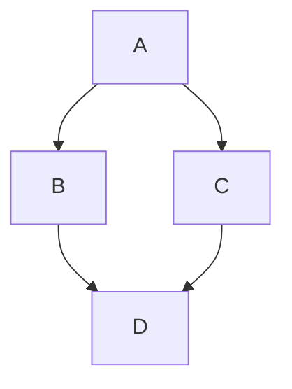

# Overview

Goal of this post is to describe [Asynchronous Entanglement Routing for the Quantum Internet](https://arxiv.org/abs/2312.14300) with focus on the results _and_ open problems. To provide full picture I will compare it with approach described in [Distributed Routing in a Quantum Internet](https://arxiv.org/abs/1907.11630). The post will be structured in a following way -- in the first section I will describe (on a high level) problem that is being addressed in the main article, in the second section we will go through foundational blocks and context required to understand the paper, in third section I will describe main contribution from the paper, fourth section will contain comparison with the approach from the second paper, fifth section will contain open problems as described in the paper.

## Why this particular structure?

I believe this approach facilitate better understand - both for reader and for me as a writer of this notes. Having clear picture of _what particular problem_ authors are trying to solve is critical to understanding the solution and somewhat appreciate it. Then, before diving into main contribution (which is a solution to a stated problem), we need to ensure that we are standing on solid foundation. Usually parts like ''Section II'' are bit boring, yet they are helpful to fully grasp solution described in ''Section III''.

# Section I: Problem definition

In the article it is Section 3. ''Quantum network'' is a network -- mathematically represented by a graph -- which leverages some quantum specific properties, in this case [entanglement](https://en.wikipedia.org/wiki/Quantum_entanglement). Graph $G(V, E)$ consists of a set of _vertices_ $V$ (nodes, ''quantum devices'') and a set of _edges_ $E$ (fibers, connection between nodes). Entanglement gives us possibility to create also _virtual edges_ between particular vertices. Let us focus on that - what is a virtual edge? We will consider simple graph consisting of three nodes - $A, B, C$. 

# Section II: Context and prerequisites

# Section III: Main contribution

# Section IV: Comparison with ''Distributed Routing in a Quantum Internet''

# Section V: Open problems, future work and potential direction

