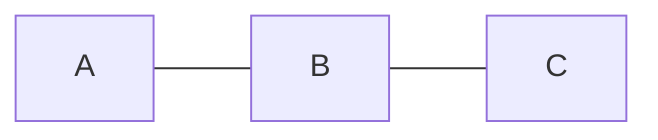
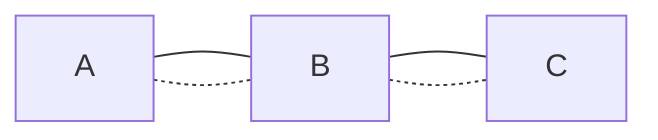
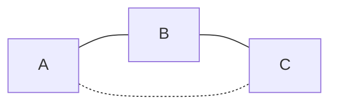
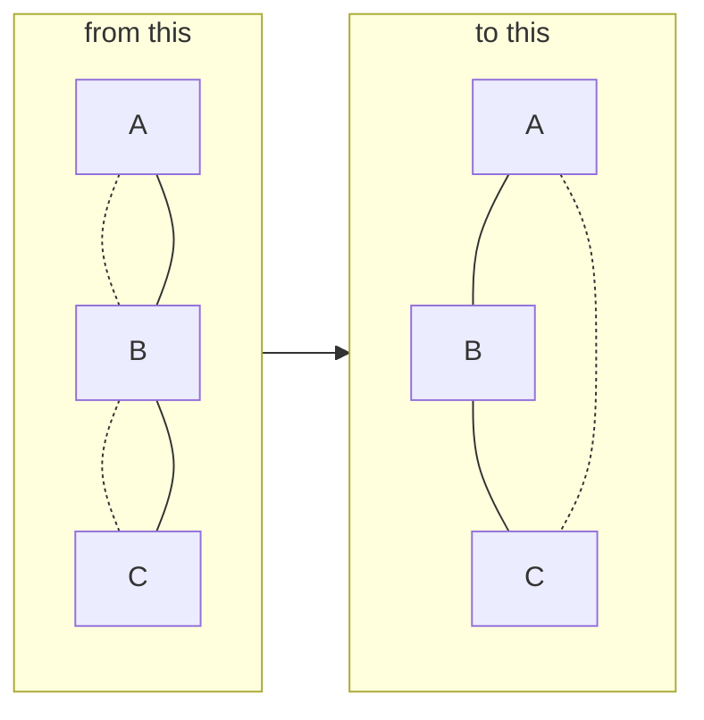

# Overview

Goal of this post is to describe [Asynchronous Entanglement Routing for the Quantum Internet](https://arxiv.org/abs/2312.14300) with focus on the results _and_ open problems. To provide full picture I will compare it with approach described in [Distributed Routing in a Quantum Internet](https://arxiv.org/abs/1907.11630). The post will be structured in a following way -- in the first section I will describe (on a high level) problem that is being addressed in the main article, in the second section we will go through foundational blocks and context required to understand the paper, in third section I will describe main contribution from the paper, fourth section will contain comparison with the approach from the second paper, fifth section will contain open problems as described in the paper.

## Why this particular structure?

I believe this approach facilitate better understand - both for reader and for me as a writer of this notes. Having clear picture of _what particular problem_ authors are trying to solve is critical to understanding the solution and somewhat appreciate it. Then, before diving into main contribution (which is a solution to a stated problem), we need to ensure that we are standing on solid foundation. Usually parts like ''Section II'' are bit boring, yet they are helpful to fully grasp solution described in ''Section III''.

# Section I: Problem definition

Given set of ''quantum devices'' (capable of entanglement generation and swapping) connected via network capable of qubit transmission -- how we can _efficiently_ create entanglement between any two devices in the network?

## Context

In the article it is Section 3. ''Quantum network'' is a network -- mathematically represented by a graph -- which leverages some quantum specific properties, in this case [entanglement](https://en.wikipedia.org/wiki/Quantum_entanglement). Graph $G(V, E)$ consists of a set of _vertices_ $V$ (nodes, ''quantum devices'') and a set of _edges_ $E$ (fibers, connection between nodes). Entanglement gives us possibility to create also _virtual edges_ between particular vertices. Let us focus on that - what is a virtual edge? We will consider simple graph consisting of three nodes - $A, B, C$. The solid lines represents physical link between two devices.

Now, each node represents quantum device. Each device can communicate _qubits_ to its neighbour (so another node that is directly connected). Such pair of nodes can create entanglement between their states. In our graph we (in theory) entangle states of $A, B$ and $B, C$. We will represent entanglement between nodes with dotted line.

By using technique called _entanglement swapping_ we can "sacrifice" entanglements between $A, B$ and $B, C$ to create entanglement between $A, C$!

What's the benefit? Now pair $A, C$ is entangled and they can leverage ''quantum effects'' - for example in quantum key distribution. Of course as networks grow larger, keeping in mind intermittent and delicate nature of entanglement between nodes, the question of how to create entanglement between any two particular nodes in a network gets harder and harder. Hence, we get our original problem statement.

# Section II: Prerequisites and problem statement refinement

Before we can fully jump into contribution of the paper we need to understand what _building blocks_ are leveraged in proposed approach. First we will describe processes or ''functions'', then we will describe components that leverage these.

## Entanglement generation between adjacent nodes

Most basic capability is to entangle qubits between two adjacent nodes in a network. Simplest way would be to generate [EPR pair](https://en.wikipedia.org/wiki/Bell_state#Creating_Bell_states_via_quantum_circuits) between in node $A$ and then send one of the entangled qubits to connected (via physical link) node $B$.

## Entanglement swapping

With the information above we can generate entanglement between physically connected nodes, but what about situation where we have intermediary node? 

There is existing technique called [entanglement swapping](https://en.wikipedia.org/wiki/Quantum_teleportation#Entanglement_swapping), which allows us to do exactly that. In linked example there is a 
algorithmic description of the process, whereas in the paper you can find circuit-level realisation.

## Fidelity

Fidelity between two quantum states can be intuited as "similarity" between those two states. Higher fidelity between two states means that two states are more similar to each other. In case of pure states fidelity can be thought as angle between two vector states.

## Entanglement purification

This is a procedure that takes a number of partially entangled states and produces a smaller number (not rarely - just one) state with higher measure of entanglement.

## Global and local (node-level) knowledge of direct links

First - what is a direct link? Given two nodes in the network, "direct link" is an edge realised by entanglement between those two nodes.
The "global knowledge" is information about states of all direct links between all nodes in the network. It completely describes entanglement between all nodes. In a perfect (yet somewhat imaginary) world every node would have access to that global knowledge, but in a distributed scenario - the state information in any node might be outdated hence it has a "local knowledge". If you are coming from CS perspective - this simply means [eventual consistency](https://en.wikipedia.org/wiki/Eventual_consistency)

## Link capacity

This is a number representing how many entangled qubit pairs can be generated between two nodes. If we would have ''prefect'' technology it would simply be equal to number of pairs between two nodes, but physical realisation within current state of the art implies that  -- if we want to achieve specific fidelity with EPR pair -- we might need multiple entangled pairs and leverage purification techniques.

## Synchronous and asynchronous

Title of the article contains "asynchronous", hence it would be good to explain what does it mean. From a programmer perspective (or _thread_ perspective) synchronous means that you wait for task to finish before working on next task. When you execute some task asynchronously - you can delegate the work to another ''thread'' (or other entity of similar type) and work on something else between you get the result back.

Overall, this is a very deep ocean, especially in world of algorithm analysis -- so let us try to narrow down what it does mean in context of the paper. It simply means that nodes in the network can perform operations (for example - creating entanglement) simultaneously, without any "global" coordination. 

## Entanglement rate

This value represents how much entanglement can be generated in a unit of time. Paraphrasing from paper: _It is the performance metric indicating the number of end-to-end entanglements (Bell states) that can be generated in a unit time $T$_.

## Refined problem statement

This section will contain more mathematically precise statement of the problem. It is heavily based on Section 3 of the paper.

Let graph $G(V, E)$ represent topology of a quantum network. Each node $v \in V$ represents a quantum repeater (capable of entanglement generation and swapping), while each edge $e \in E$ represents physical (e.g. fiber optic) node that connects two repeaters. Let $G'(V', E')$ be a graph, where $V' \subseteq V$. $G'$ represents quantum repeaters that are connected with each other via direct entanglement. Hence $e' \in E'$ represents entanglement connection (in the paper this is called ''direct-link entanglement''). 

Each edge $e \in E$ has associated value $C(e)$ which represents _capacity_ of the link. Capacity is defined as maximum number of entangled pairs that can be generated between nodes connected by $e$. Moreover, each vertex $v \in V'$ also has capacity - $C(v)$, which is defined simply as number of qubits in that particular vertex (remember - vertex is simply a quantum repeater). $C(v)$ is defined as at least equal to sum of capacities of edges that connect $v$ with its neighbours $N(v)$. $C(v) \geq \sum_{e \in N(v)}C(e)$. This will allow us to simplify analysis, because there is no "competition" for qubits between links. 

As mentioned before due to limitations of our technology to achieve desired fidelity $f$ (with EPR pair), we need $E(f)$ entanglement pairs to obtain it (via purification). We also define $T_{co}$, which is an _average coherence time_. It can be understood as how long we can actually maintain entanglement. After that time (on average) we will loose entanglement between two nodes. 

In the paper - to simplify the analysis - each link capacity $C(e)$ and $E(f)$ are equal to $1$.

For each entanglement generation that happens between nodes connected via edge $e$ there is probability $p(e)$ that generation will succeed. At each node $v$ there is probability of entanglement swapping succeeding denoted as $q(v)$. To simplify things authors of the paper denote equal $p(e)$ for all edges $e$ -- denoted simply as $p$. Analogously, $q$ represents success probability for entanglement swapping for all $v$.

Entanglement rate $\zeta$ represents number of Bell states that can be generated in unit time $T \leq T_{co}$. This last inequality makes sense, because it allow us to narrow down time window to only consider generation of entanglements that all can "live" at the same time. 

Moreover, additional (but important) constraint that authors put on themselves is that nodes only posses local knowledge about adjacent entanglement links.

So the refined problem statement would be - given all of the above and assuming asynchronicity - how to design an algorithm that maximizes entanglement rate $\zeta$.

# Section III: Main contributions

I think one of the sentences gives good insight into inspiration for the approach taken by the authors (Section 3, page 8):

> characteristic of entanglement resembles connection-oriented circuit switching rather than the connection-less packet switching used in classical networking.

Given that this is important let's understand what is _connection-oriented circuit switching_ and _connection-less packet switching_.

First the latter one.
https://chat.openai.com/c/811444c4-4a99-47b8-81a7-347c4c43467f
https://gemini.google.com/app/7a35b6889a5e4380

## Overview

# Section IV: Comparison with ''Distributed Routing in a Quantum Internet''

# Section V: Open problems, future work and potential direction
	
