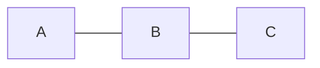
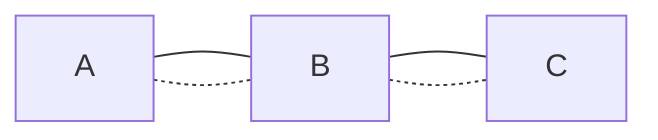
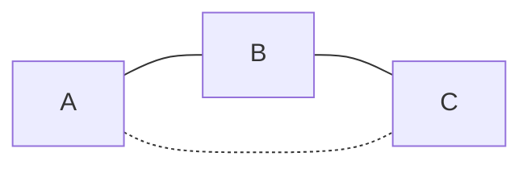
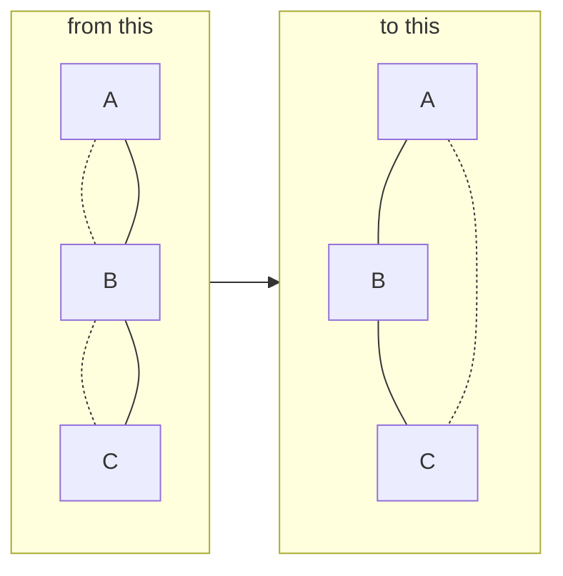
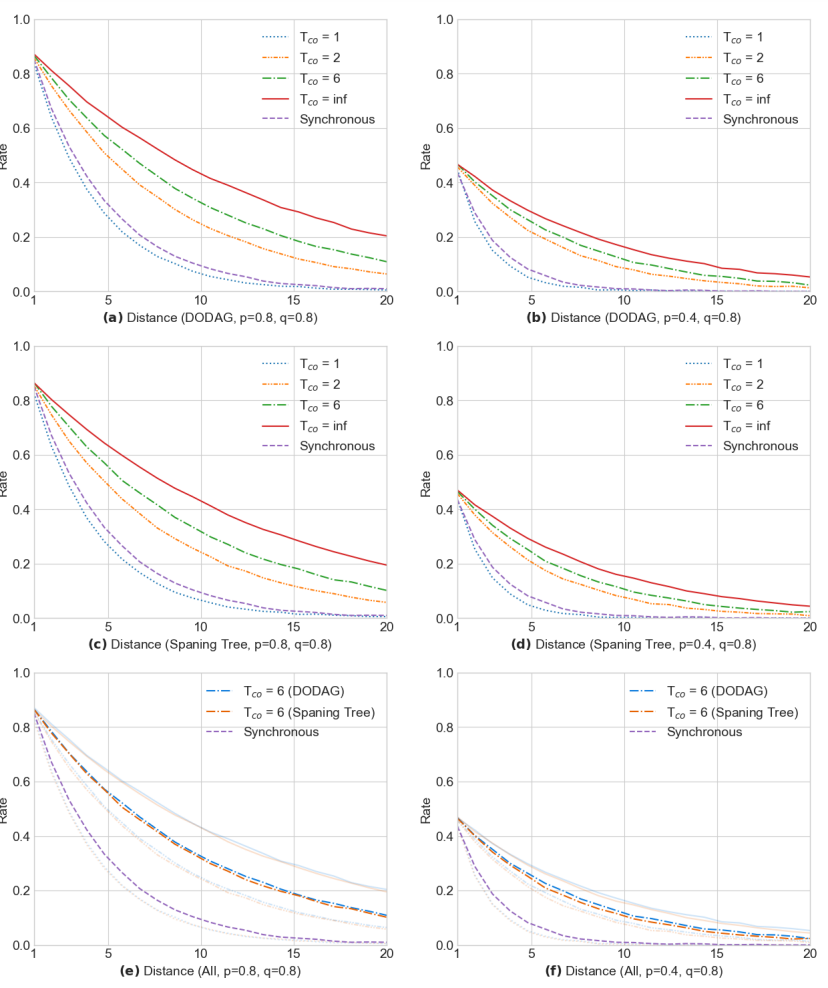
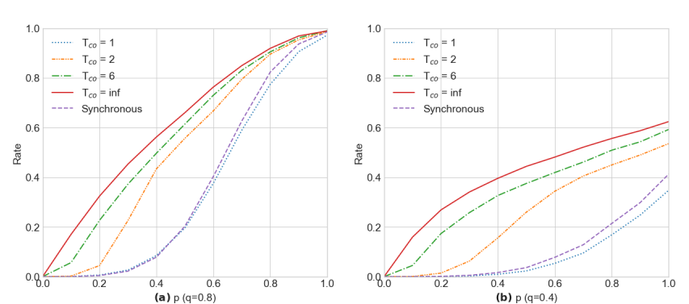
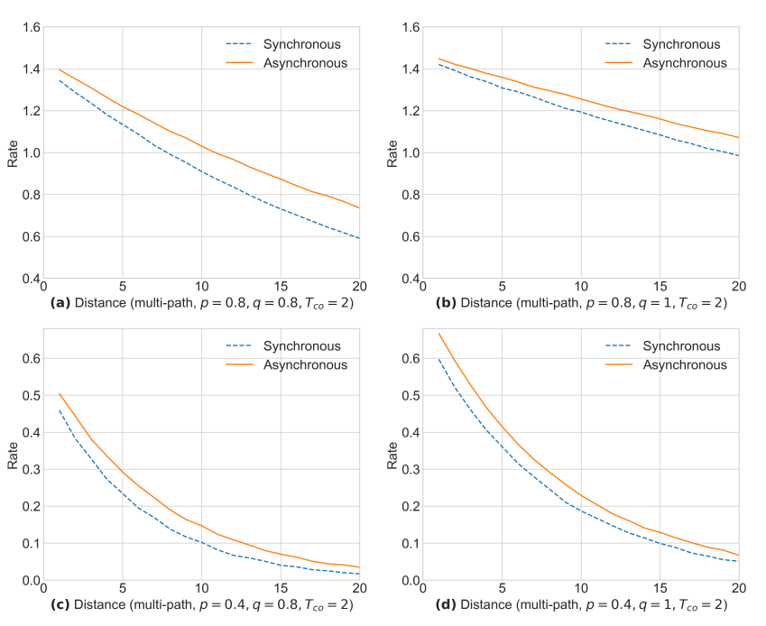

# Overview

Goal of this post is to describe [Asynchronous Entanglement Routing for the Quantum Internet](https://arxiv.org/abs/2312.14300) with focus on the results _and_ open problems. The post will be structured in a following way -- in the first section I will describe (on a high level) problem that is being addressed in the main article, in the second section we will go through foundational blocks and context required to understand the paper, in third section I will describe main contribution from the paper, fourth section will contain details about simulation setup and results, fifth section will contain open problems as described in the paper.

## Why this particular structure?

I believe this approach facilitate better understand - both for reader and for me as a writer of this notes. Having clear picture of _what particular problem_ authors are trying to solve is critical to understanding the solution and somewhat appreciate it. Then, before diving into main contribution (which is a solution to a stated problem), we need to ensure that we are standing on solid foundation. Usually parts like ''Section II'' are bit boring, yet they are helpful to fully grasp solution described in ''Section III''.

# Section I: Problem definition

Given set of ''quantum devices'' (capable of entanglement generation and swapping) connected via network capable of qubit transmission -- how we can _efficiently_ create entanglement between any two devices in the network?

## Context

In the article it is Section 3. ''Quantum network'' is a network -- mathematically represented by a graph -- which leverages some quantum specific properties, in this case [entanglement](https://en.wikipedia.org/wiki/Quantum_entanglement). Graph $G(V, E)$ consists of a set of _vertices_ $V$ (nodes, ''quantum devices'') and a set of _edges_ $E$ (fibers, connection between nodes). Entanglement gives us possibility to create also _virtual edges_ between particular vertices. Let us focus on that - what is a virtual edge? We will consider simple graph consisting of three nodes - $A, B, C$. The solid lines represents physical link between two devices.



Now, each node represents quantum device. Each device can communicate _qubits_ to its neighbour (so another node that is directly connected). Such pair of nodes can create entanglement between their states. In our graph we (in theory) entangle states of $A, B$ and $B, C$. We will represent entanglement between nodes with dotted line.


By using technique called _entanglement swapping_ we can "sacrifice" entanglements between $A, B$ and $B, C$ to create entanglement between $A, C$!



What's the benefit? Now pair $A, C$ is entangled and they can leverage ''quantum effects'' - for example in quantum key distribution. Of course as networks grow larger, keeping in mind intermittent and delicate nature of entanglement between nodes, the question of how to create entanglement between any two particular nodes in a network gets harder and harder. Hence, we get our original problem statement.

# Section II: Prerequisites and problem statement refinement

Before we can fully jump into contribution of the paper we need to understand what _building blocks_ are leveraged in proposed approach. First we will describe processes or ''functions'', then we will describe components that leverage these.

## Entanglement generation between adjacent nodes

Most basic capability is to entangle qubits between two adjacent nodes in a network. Simplest way would be to generate [EPR pair](https://en.wikipedia.org/wiki/Bell_state#Creating_Bell_states_via_quantum_circuits) between in node $A$ and then send one of the entangled qubits to connected (via physical link) node $B$.

## Entanglement swapping

With the information above we can generate entanglement between physically connected nodes, but what about situation where we have intermediary node?



There is existing technique called [entanglement swapping](https://en.wikipedia.org/wiki/Quantum_teleportation#Entanglement_swapping), which allows us to do exactly that. In linked example there is a
algorithmic description of the process, whereas in the paper you can find circuit-level realisation.

## Fidelity

Fidelity between two quantum states can be intuited as "similarity" between those two states. Higher fidelity between two states means that two states are more similar to each other. In case of pure states fidelity can be thought as angle between two vector states.

## Entanglement purification

This is a procedure that takes a number of partially entangled states and produces a smaller number (not rarely - just one) state with higher measure of entanglement.

## Global and local (node-level) knowledge of direct links

First - what is a direct link? Given two nodes in the network, "direct link" is an edge realised by entanglement between those two nodes.
The "global knowledge" is information about states of all direct links between all nodes in the network. It completely describes entanglement between all nodes. In a perfect (yet somewhat imaginary) world every node would have access to that global knowledge, but in a distributed scenario - the state information in any node might be outdated hence it has a "local knowledge". If you are coming from CS perspective - this simply means [eventual consistency](https://en.wikipedia.org/wiki/Eventual_consistency)

## Link capacity

This is a number representing how many entangled qubit pairs can be generated between two nodes. If we would have ''prefect'' technology it would simply be equal to number of pairs between two nodes, but physical realisation within current state of the art implies that  -- if we want to achieve specific fidelity with EPR pair -- we might need multiple entangled pairs and leverage purification techniques.

## Synchronous and asynchronous

Title of the article contains "asynchronous", hence it would be good to explain what does it mean. From a programmer perspective (or _thread_ perspective) synchronous means that you wait for task to finish before working on next task. When you execute some task asynchronously - you can delegate the work to another ''thread'' (or other entity of similar type) and work on something else between you get the result back.

Overall, this is a very deep ocean, especially in world of algorithm analysis -- so let us try to narrow down what it does mean in context of the paper. It simply means that nodes in the network can perform operations (for example - creating entanglement) simultaneously, without any "global" coordination.

On the page 3, authors mention that existing (synchronous) approaches are generally divided in two phases -- external and internal. During the "external" phase, adjacent nodes establish entanglement between each other. During the "internal" phase -- nodes are only aware of entanglement status of their neighbours -- (quoting from article) "each repeater node swaps entanglement blindly to reach an end-to-end entanglement" between source and target nodes. If the source-target connection is not achieved, process is repeated. The "synchronous" aspect comes from the fact that internal phase needs all entanglement links built in external phase. Moreover, _all entanglements_ are consumed in each time slot. Time slot consists of external + internal phase.

## Entanglement rate

This value represents how much entanglement can be generated in a unit of time. Paraphrasing from paper: _It is the performance metric indicating the number of end-to-end entanglements (Bell states) that can be generated in a unit time $T$_.

## Refined problem statement

This section will contain more mathematically precise statement of the problem. It is heavily based on Section 3 of the paper.

Let graph $G(V, E)$ represent topology of a quantum network. Each node $v \in V$ represents a quantum repeater (capable of entanglement generation and swapping), while each edge $e \in E$ represents physical (e.g. fiber optic) node that connects two repeaters. Let $G'(V', E')$ be a graph, where $V' \subseteq V$. $G'$ represents quantum repeaters that are connected with each other via direct entanglement. Hence $e' \in E'$ represents entanglement connection (in the paper this is called ''direct-link entanglement'').

Each edge $e \in E$ has associated value $C(e)$ which represents _capacity_ of the link. Capacity is defined as maximum number of entangled pairs that can be generated between nodes connected by $e$. Moreover, each vertex $v \in V'$ also has capacity - $C(v)$, which is defined simply as number of qubits in that particular vertex (remember - vertex is simply a quantum repeater). $C(v)$ is defined as at least equal to sum of capacities of edges that connect $v$ with its neighbours $N(v)$. $C(v) \geq \sum_{e \in N(v)}C(e)$. This will allow us to simplify analysis, because there is no "competition" for qubits between links.

As mentioned before due to limitations of our technology to achieve desired fidelity $f$ (with EPR pair), we need $E(f)$ entanglement pairs to obtain it (via purification). We also define $T_{co}$, which is an _average coherence time_. It can be understood as how long we can actually maintain entanglement. After that time (on average) we will loose entanglement between two nodes.

In the paper - to simplify the analysis - each link capacity $C(e)$ and $E(f)$ are equal to $1$.

For each entanglement generation that happens between nodes connected via edge $e$ there is probability $p(e)$ that generation will succeed. At each node $v$ there is probability of entanglement swapping succeeding denoted as $q(v)$. To simplify things authors of the paper denote equal $p(e)$ for all edges $e$ -- denoted simply as $p$. Analogously, $q$ represents success probability for entanglement swapping for all $v$.

Entanglement rate $\zeta$ represents number of Bell states that can be generated in unit time $T \leq T_{co}$. This last inequality makes sense, because it allow us to narrow down time window to only consider generation of entanglements that all can "live" at the same time.

Moreover, additional (but important) constraint that authors put on themselves is that nodes only posses local knowledge about adjacent entanglement links.

So the refined problem statement would be - given all of the above and assuming asynchronicity - how to design an algorithm that maximizes entanglement rate $\zeta$.

# Section III: Main contributions

Before we dive into particular contributions, let us go through various ideas, tools and constructs used by authors to better understand main results

## Connected-oriented circuit switching vs connection-less packet switching

I think one of the sentences gives good insight into inspiration for the approach taken by the authors (Section 3, page 8):

> characteristic of entanglement resembles connection-oriented circuit switching rather than the connection-less packet switching used in classical networking.

Given that this is important let's understand what is _connection-oriented circuit switching_ and _connection-less packet switching_.

First the latter one.

In connection-less packet switching data is divided into _packets_ and each such _packet_ is treated independent unit. There is no pre-established path for data transmission for every packet. Packets may take different routes to reach the destination, and they might arrive out of order. The network nodes make routing decisions based on the current network conditions.

In connection-oriented circuit switching a dedicated communication path (known as circuit) is established between two parties before any data transfer occurs. The path remains reserved for the duration of the connection.

The entanglement cannot be split into parts, we need to reserve particular path to entangle nodes connected by that path. That's why the connected oriented approach seems like a more natural fit.
## DODAG

DODAG is an acronym that stands for _destination oriented directed acyclic graph_. The DAG part is usually well-known, especially in computer science world. The core property of DAG is having directed edges which form a path _without_ cycles. So going on any path on that graph will not bring you to place you've been before.

DODAG is a specific type of DAG that is leveraged in lossy networks (think of dynamic IoT scenario). The additional property to designate one of the vertices as a _root node_ that will have no outgoing edges. All other nodes in the graph can be reached from the root by following the directed edges.

## Spanning tree

Spanning tree will also be leveraged within the paper. Given graph $G(V, E)$ its spanning tree is another graph that contains the same set of vertices $V$, _but_ it contains minimum possible number of edges to retain same connections as original graph have (connection here means being able to go from vertex $a$ to vertex $b$)

## Distributed graph

Distributed graph is a type of graph where each vertex/node is a _computing unit_ -- in our case it is a quantum repeater.

## Instant topology

Instant topology refers to a topology of a graph that is built from quantum repeater (nodes) that are connected via entanglement (edges)

## Getting to the point

With that long preface and all concepts, we can finally get to describing the key results of the paper. Whew!

### Key idea

This is based heavily on section 4 of the article.

I think that good mental model for the _asynchronous routing scheme_ is a service (from software perspective). It is constantly "on" and reacts to particular queries (simplest example is some form of simple http server).

This "routing service" is built from two main components: distributed graph and path determinator.

First component -- the "distributed graph" -- is responsible for building and maintaining instant topology as a distributed graph. Second component is more of a server which respond to actual requests. If you are software engineering savvy, this routing scheme have traits of a reactive system.

Given my personal software engineering context, I'll try to represent the scheme in a pseudocode.An instance of class below would run on every node/vertex/quantum repeater in the network.

```python
class AsynchronousRouterNode:
    distributed_graph_component # responsible for building and maintaining instant topology 
    current_node = self

    # On instance startup
    def startup():
        distributed_graph_component.join(current_node)

    # This function would be called as a classical operation with "classical bits"
    def navigate(previous_node, destination_node):
        maybe_next_node = distributed_graph_component.next_hop_determination(current_node, destination_node)
        if maybe_next_node is None:
            # a naive retry - try to join this node to distributed graph and retry the request
            distributed_graph_component.join(current_node)
            navigate(previous_node, destination_node)
        else:
            next_node = maybe_next_node
            es_success = entanglement_swap(previous_node, next_node)
            if not es_success: # if entanglement swapping failed
                # once again - a naive retry.
                distributed_graph_component.join(current_node)
                navigate(previous_node, destination_node)
            else:
                emit_connection_request_to(next_node, destination_node, current_node)
```

This relatively short pseudocode gives good overview and shows that even if we get complicated behavior (asynchronous entanglement swapping) behaviour of an individual node is simple:
1. On startup connect to the `distributed_graph_component`
2. On request -- try to swap entanglement between previous node and next node. Here the important part is that `distributed_graph_component` maintains information about instant topology (where edges represents entanglement between nodes). If something fails - try to rejoin the graph and retry the request.

We can see an unsafe infinite loop here (infinite retry), but this is of course just a pseudocode, so I can live with that.

The important questions that arises - how we can realise the `distributed_graph_component`. From perspective of individual node this is completely opaque, but of course - we are interested in performance on an _actual_ solution. Authors propose two "protocols" that implements the component -- DODAG and Spanning Tree. I believe it is worthwhile to understand both approaches (at least on a high level). On the other hand there is possibility to implement other protocols as we develop the science behind it. For detailed explanation please refer to the paper - esp. section 4.

To give even more intuition on "how this works" let me quote from the conclusion section:
"We treat all network nodes as vertices in a graph that try to connect their neighbours using direct-link entanglements. No central control and no global knowledge of the direct-link entanglements are needed in our method. Whenever a pair of nodes wants to create an end-to-end entanglement, they go through the distributed graph that is continuously updated to find each other"


# Section IV: Simulation setup and results

Now to the results. Authors provided interesting model, especially the fact that it moves towards asynchronicity -- which seems like a more natural fit for a network. The question remains if it is better than the synchronous approach.

## Experiment setup

Authors utilise entanglement rate (as defined above) $\zeta$ as a performance metric. They run the experiment on a 2D grid topology. Each node is connected to 4 other nodes (neighbours), with exception of edge nodes (those are connected to 3 neighbours) and ''corners'' (those are connected to 2 neighbors). Each node is only aware of the neighbours' statuses of entanglement (direct links in an instant topology) and has _no_ awareness about anything "larger" than that.

Authors use [NetworkX](https://networkx.org/) python library to conduct the simulation. Simulation happens (as mentioned above) in a 2D grid network. It is not clearly stated in the paper what is the size of the grid, but from the description of the Figure 10, we might think that it is around $26 \times 26$.

## Synchronous protocol

Authors compare results to "synchronous" protocol. Authors do not describe precisely what protocol they are comparing against, so I assume that they leverage what they described in section 5.1. For us the main interest would be entanglement rate in synchronous protocol:

$$
\zeta_{syn}(s, t) = p^{l_{s,t}}q^{l_{s,t}-1}n_{s,t}
$$

Let us unpack:
- $s$ means source node
- $t$ is target node
- $p$ is probability of success of entanglement between adjacent nodes
- $q$ is probability of success of entanglement swap
- $l_{s,t}$ is the mean length of all possible paths between nodes $s$ and $t$
- $n_{s,t}$ average number of disjoint paths between $s$ and $t$ as $n_{s,t}$


## On $T_{co}$

To fully grasp simulation results, how coherence time -- $T_{co}$ -- is leveraged. $T_{co}$ represents coherence time or "how long entanglement is alive and usable". Entanglement _rate_ means that we are talking about how much entanglement we can generate per unit time $T$. For simulations (and analysis) to be meaningful we must assume that $T \leq T_{co}$ -- otherwise we would not have available entanglement after single time unit. Authors decided to represent $T_{co}$ as $n$ unit times, so $T_{co} = 3$ represents coherence time of 3 unit times. Unit time is equivalent to ''one time slot in synchronous operation'', but it is not clearly defined what it means. Entanglement rate for synchronous protocol is independent of $T_{co}$.

## Results

>  Graphs are taken from [Asynchronous Entanglement Routing for the Quantum Internet](https://arxiv.org/abs/2312.14300)

### Rate vs Distance (single-path)



Single-path means that we search only for one path between source and destination nodes.

First thing to notice is that for $T_{co} = 1$ synchronous approach beats asynchronous one. It makes sense, as there is an "additional baggage" for async communication -- which does not exist in synchronous approach. But, with $T_{co} = 2$ asynchronous protocols are beating synchronous approach.

### Rate vs Entanglement Generation success



Here we can see similar results -- async approaches are better when coherence time increases, interesting question is that if we $p$ and $q$ approach $1$ - would we observe any difference? Graph on the left shows that with high values of $p$ and $q = 0.8$ we see almost no difference.


### Rate vs Distance (multi-path)



Multi-path means that we search for disjoint paths between source and target nodes. Once again the async approaches beat synchronous approach (but not that much).

# Section V: Open problems, future work and potential directions

## Network of networks

Authors claim that DODAG roots can serve as gateways to connect multiple networks (constructing network of networks). Leveraging DODAG for async routing (as presented in this article) of network of networks is a direction for future exploration.

## Root position

Authors took center of the network as DODAG's root, but taking different nodes as roots and impact of that decision on entanglement rate warrants further investigation.

## Networking properties

Aspects like using (quoting/paraphrasing) "untrusted repeaters, minimal trust between network, malicious nodes, order of entanglement swapping along a path"

## Network shapes

Performance of routing schemes in networks with shape other than grid.

### Personal propositions

- Are there different structures other than DODAG?
- What results for $T_{co} \in (1, 2)$?
- More granular comparisons with different synchronous algorithms
- (far-fetched) can we learn something from blockchain related research? 
