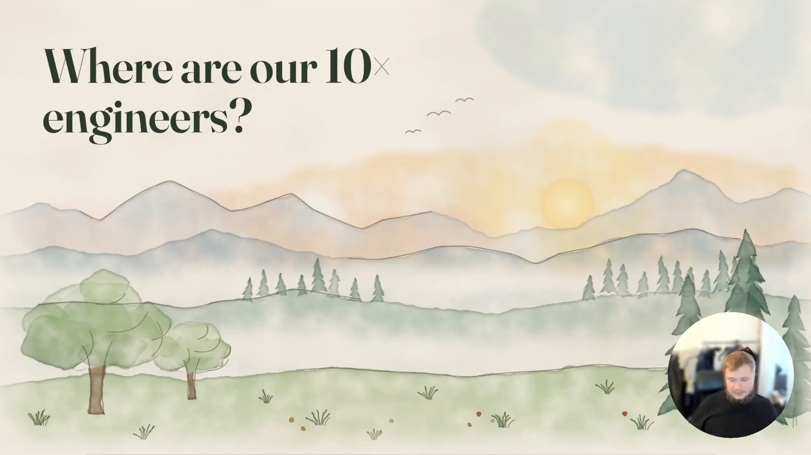
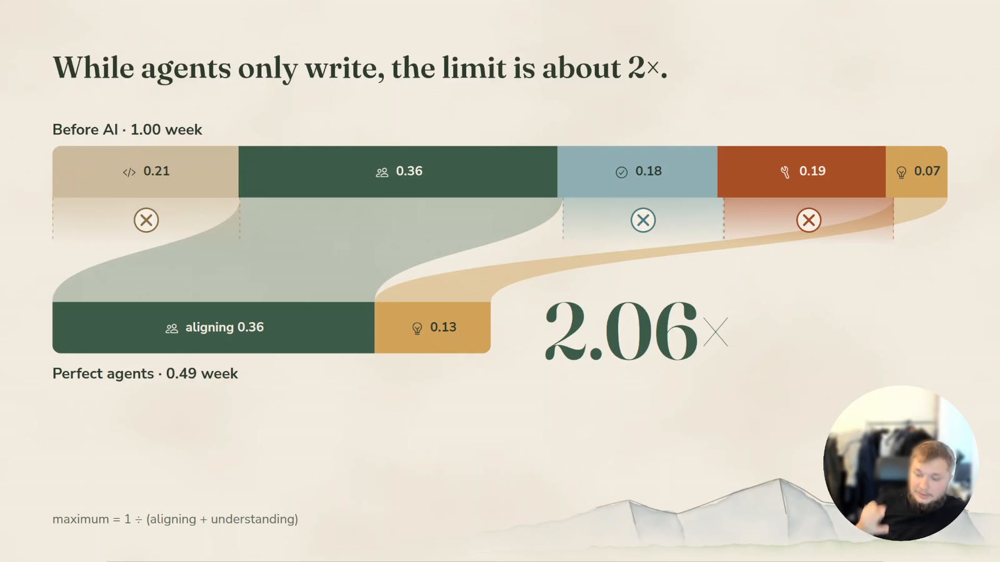
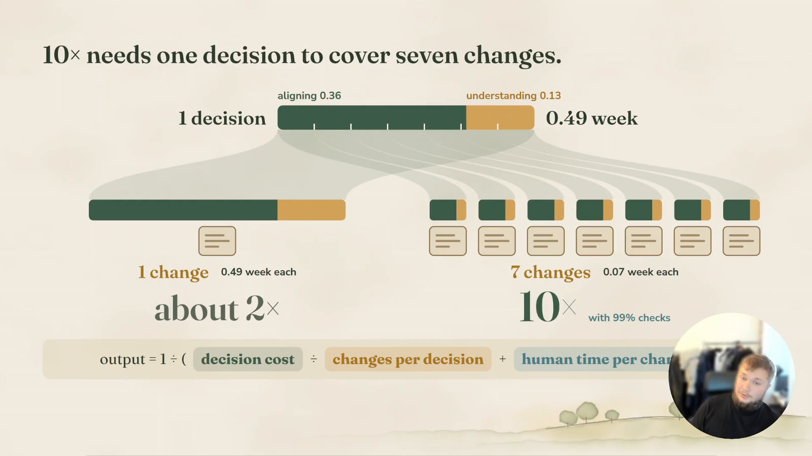
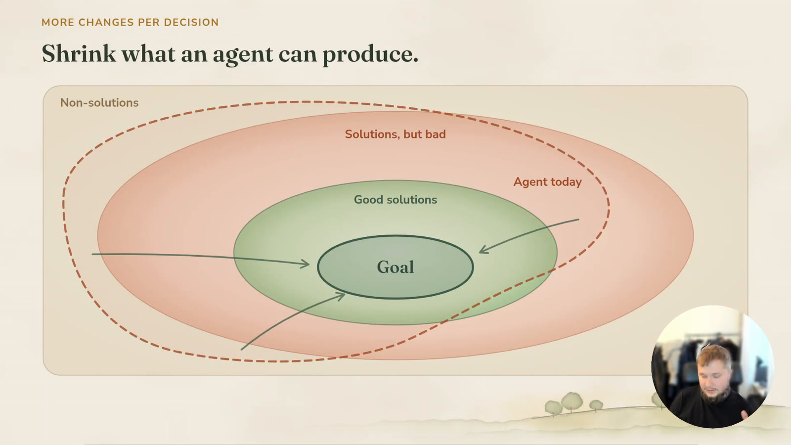
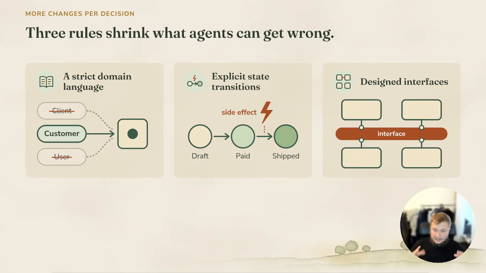
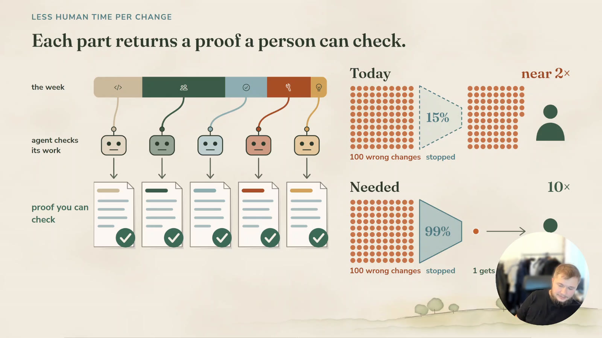
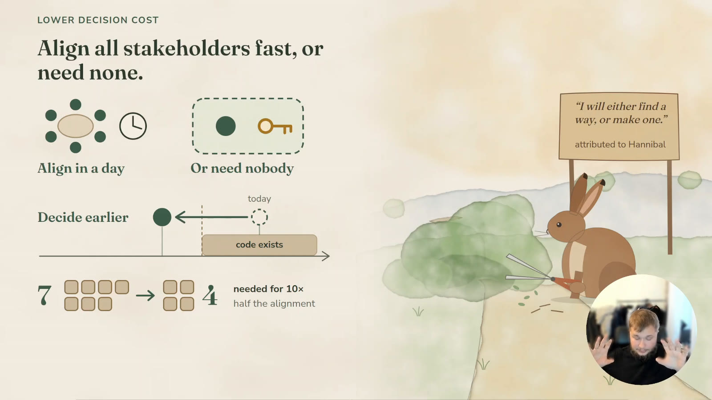
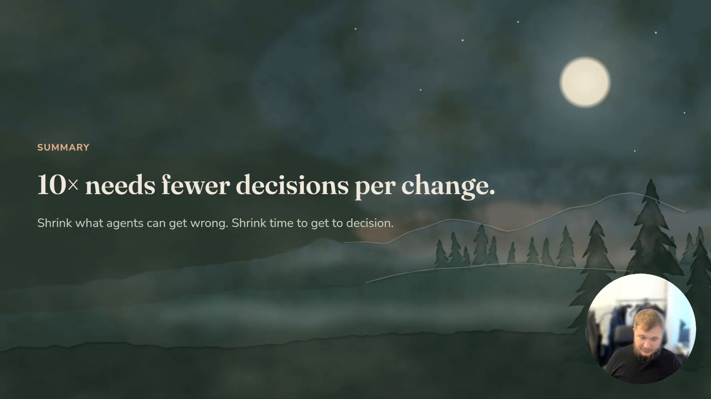

Agents write most of my code now. Typing it myself is close to 0% of my week. So where are our 10× engineers?

I recorded a 20-minute talk about that question. This post is the written walkthrough: the same model, one step at a time, with the charts and the numbers. You can check my work instead of trusting my slides. The video is right below, and each step links to its moment in the talk.



One warning first. The formula below is a guidepost, not a strict rule. I think it is still useful, because it puts numbers on an argument that usually runs on anecdotes.

## Step 1: where an engineer's week goes

*In the talk: [1:57](https://www.youtube.com/watch?v=go_Fjw_51W4&t=117s)*

Start with a week before any agent. A Microsoft survey (Meyer et al., IEEE TSE 2021) asked 5,928 developers where their last workday went. Writing code was 21% of the productive time. The rest was aligning (36%), checking (18%), repairing (19%) and understanding (7%).

So even before AI, writing was about one fifth of the job.

Then agents arrived. The 2026 data I used in the talk shows writing down to about 3%. The other four parts did not shrink with it:

- Review time per PR went up 58%.
- Follow-up fixes went up 1.62×.
- Meeting time went up 16% (Anthropic), even though the share of the week for aligning fell a little, to 34%.
- Understanding grew from 7% to 12%. If you don't write the code, the natural way to understand it is to read it, and reading takes time.



## Step 2: the 2× ceiling

*In the talk: [4:17](https://www.youtube.com/watch?v=go_Fjw_51W4&t=257s)*

Now imagine perfect agents. Writing is free. Nobody reviews anything. Nothing breaks.

What is left is aligning (0.36 of a week) and understanding (0.13). One change now costs 0.49 of a week instead of 1.00. That is 1 ÷ 0.49 = 2.06×.

Two. Not ten.

And that is the best case. Real agents ship bugs, and someone has to check their work.

## Step 3: the formula

*In the talk: [5:05](https://www.youtube.com/watch?v=go_Fjw_51W4&t=305s)*

To include checking and bugs, I use one formula for the output of one person:

$$
T = \frac{\text{week}}{\text{write} + \text{align} + \dfrac{\text{check} + p \cdot \text{repair}}{1 - p} + \text{understand}}
$$

| Term | What it means |
|---|---|
| $T$ | Good changes per person per week. A change counts if it is still live after 30 days. |
| write | Time people still spend writing code |
| align | Meetings and specs |
| check | Review |
| $p$ | The share of changes that are defective |
| repair | The time to fix a defective change |
| $1 - p$ | Only good changes count |
| understand | Reading and understanding code you did not write |

Dividing by $1 - p$ is the part I care about most. It stops you from counting more defects, or more volume, as productivity.

To get a high $T$, you need a small denominator. That is the whole game. Paste the formula into your AI of choice and poke around with it.

## Step 4: the defect rate decides if you gain at all

*In the talk: [7:26](https://www.youtube.com/watch?v=go_Fjw_51W4&t=446s)*

I think a lot of the community sees this by now: the error rate of the agent is the most important number. Here is the model from the talk, with agents that write ten times faster, for every defect rate from 0% to 50%:



- At 40% defective changes, you end up at 0.79×. That is slower than before AI.
- At 30%, you are at 0.95×. Still slower.
- At 20%, you gain a little: 1.14×.
- The break-even point is about 27%.

Those defect rates sound high. Many organizations live with them anyway. And even at 0% defects, the curve starts at 1.92×. The ceiling from step 2 is still there.

## Step 5: what 10× takes

*In the talk: [8:53](https://www.youtube.com/watch?v=go_Fjw_51W4&t=533s)*

The ceiling comes from aligning and understanding. So 10× has to change those terms. Faster writing does nothing for them.

### One decision must cover more changes

*In the talk: [9:32](https://www.youtube.com/watch?v=go_Fjw_51W4&t=572s)*

If you need to agree on every single change, the inertia of social interaction slows you down. With one change per decision, you get about 2×. With seven changes per decision, and checks that stop 99% of bad changes, you get 10×.

My camera bubble covers the formula at the bottom of the slide, so here it is:

> output = 1 ÷ (decision cost ÷ changes per decision + human time per change)

So align strictly and aggressively, once, and make that one decision cover a couple of PRs.

### Shrink what an agent can produce

*In the talk: [10:40](https://www.youtube.com/watch?v=go_Fjw_51W4&t=640s)*

Point an agent at a problem with a good prompt, and it can land in four places: a non-solution, a solution that is bad, a good solution, or the goal itself. Claude drew the dashed line for me. That is an agent today: it gets to the goal, but it can also end up anywhere else.

Linters, static checks and formal verification all do one job here. They shrink the space until everything the agent produces lives inside the goal. That moves the hard problem up a level: you have to know what you want to achieve. I truly believe that stating the right goal, quickly, will be the hardest and most important part of the job. Those decisions will be the moat.

### Three rules for the codebase

*In the talk: [13:35](https://www.youtube.com/watch?v=go_Fjw_51W4&t=815s)*

Beyond linters, these are the three rules I recommend:

1. **A strict domain language**, understood by every layer of the company that builds the product. I don't mean strong types, although I like them.
2. **Explicit state transitions.** If a customer books something, the move from one state to the next is explicit, and its side effects are precisely described. A prompt I saw, "find me the implicit FSMs in my code base", is what started this whole talk.
3. **Designed interfaces.** Modules small enough to fit in a model's context, with clearly described dependencies.

Agents copy the patterns they find. Lauren Tan's inverse pyramid puts the codebase at the base for a reason. With these three rules in place, the agent writes better code on its own.

### Every change returns a proof a person can check

*In the talk: [16:06](https://www.youtube.com/watch?v=go_Fjw_51W4&t=966s)*

Use agents on all five parts of the week, including review. Today, automated checks stop maybe 15% of the wrong changes. Everything else lands on a person, who has to step back, take a look and fix it. That keeps you near 2×. For 10×, about 99% of the wrong changes must stop before a person looks, and each change has to come with a proof that a person can check quickly.

(In the video I say "50%" at [17:28](https://www.youtube.com/watch?v=go_Fjw_51W4&t=1048s). The slide is right: 15%.)

### Align all stakeholders fast, or need none

*In the talk: [18:03](https://www.youtube.com/watch?v=go_Fjw_51W4&t=1083s)*

The last lever is the decision itself. Either you align everyone in a day, or you scope the work so it needs nobody. And decide earlier: before the code exists, not after.

The formula from the "one decision" slide shows why this matters. Cut the alignment cost in half, and one decision needs to cover only four changes for 10×, instead of seven.

This favors people who can grab everyone they need, get the decision and go. I don't mean rude. I mean intense. After that, they don't think about every PR. They aligned first, and then it is agentic work.

That makes alignment, the people skill of holding a socio-technical system together, one of the most important engineering skills we have.

## Summary

*In the talk: [19:49](https://www.youtube.com/watch?v=go_Fjw_51W4&t=1189s)*

10× needs fewer decisions per change. Shrink what agents can get wrong. Shrink the time it takes to get to a decision.

Where does your week go now? Put your own five numbers into the formula and tell me what you get. If you think a term is missing, tell me that too. I'm [@petlew1](https://x.com/petlew1) on X.

## Sources

- Meyer et al., Microsoft, IEEE TSE 2021: 5,928 developers, time on their last workday.
- The 2026 data on agents: Chen & Stratton; Anthropic; Takerngsaksiri et al.; Shen & Tamkin; Kaufman et al.; ORCA-bench.
- The model and the charts are my own, built with Claude. The defect chart uses the same model code as the slides.
